# Directus v12 - Datenmodell aus `cms/snapshots/snapshot.json`

## AG Grid fuer block_table

Die lokale Instanz verwendet Directus 12.3.1. `block_table.data` verwendet das
lokale Interface `contentblock-table`, das die installierte AG-Grid-Erweiterung
1.0.2 wiederverwendet. Das Feld bleibt `json` mit `cast-json`; M2A-Verknuepfungen
und Block-IDs bleiben unveraendert. Build und Bedienung stehen in der
[Erweiterungsdokumentation](../../cms/extensions/directus-extension-contentblock-table/README.md).

### Umsetzung

| Aspekt         | Festlegung                                                      |
| -------------- | --------------------------------------------------------------- |
| Interface      | `contentblock-table`                                            |
| Spalten        | Je Tabelle aus `col_N`-Schluesseln; neue Tabellen: zwei         |
| Ueberschriften | Erste Datenzeile, individuell je Tabelle                        |
| Reihenfolge    | Sortieren/Filtern deaktiviert, damit die Kopfzeile oben bleibt  |
| Struktur       | Spalten/Zeilen hinzufuegen und mit Bestaetigung entfernen; Undo |
| Migration      | Interface-Wechsel ohne Inhaltsmigration                         |

```json
[
  { "col_1": "Art", "col_2": "Aufnahme", "col_3": "Jahresbeitrag" },
  { "col_1": "Erwachsene", "col_2": "120 EUR", "col_3": "75 EUR" }
]
```

> **Bewusste Entscheidung:** Das flache Zeilenformat bleibt erhalten, nicht
> `{ columns, rows }`. Leere Zellen erhalten ebenfalls einen `col_N`-Schluessel,
> damit leere Spalten nach Neuladen bestehen bleiben. Spaltenentfernung loescht
> die betroffenen Werte in allen Zeilen und nummeriert verbleibende Spalten
> konsistent neu. Die Kopfzeile und die letzte Spalte sind geschuetzt.
> Der Wrapper beruecksichtigt `disabled` und `nonEditable`; serverseitige
> Berechtigungen bleiben massgeblich. Mehrzelliges Excel-Paste ist nicht enthalten.

### Frontend

[tableData.ts](../../frontend/src/lib/tableData.ts) normalisiert flache Grid-Zeilen
und das alte `cells[].value`-Format fuer
[TableBlock.tsx](../../frontend/src/components/blocks/TableBlock.tsx).
Leere nachfolgende Grid-Spalten werden ausgeblendet; die erste Zeile bleibt
der Spaltenkopf. Auf breiten Bildschirmen erscheint eine semantische
HTML-Tabelle, mobil eine beschriftete Kartenliste mit denselben Werten.
Die Darstellung liegt in [TableViews.tsx](../../frontend/src/components/blocks/TableViews.tsx).
Besucher koennen alle Zeilen durchsuchen und zwischen Seiten wechseln.

Manuelle Pruefung:

1. Einen Tabellenblock in Studio oeffnen, Zelle bearbeiten, speichern und neu laden.
2. Mitgliedschaft, Gastkarten und beide Gewaesserseiten im Frontend pruefen.
3. Mobile Darstellung sowie Tastaturbedienung des Grid-Editors pruefen.

### Backend

Die Umstellung betrifft nur `block_table.data` und seine Interface-Metadaten.
Der [Schema-Snapshot](../../cms/snapshots/snapshot.json) enthaelt die Konfiguration,
aber weder Inhalte noch Erweiterungspakete. Backup und Betriebsdetails stehen
in der [CMS-Dokumentation](../../cms/README.md#directus-1231-und-ag-grid).

## Relationen

```mermaid
erDiagram
    %% ===== GLOBALE KONFIGURATION =====
    SITE }o--|| NAVIGATION : "navigation"
    SITE }o--|| FOOTER : "footer"
    SITE }o--|| THEME : "theme"
    NAVIGATION ||--o{ NAV_ITEMS : "items (O2M)"
    NAV_ITEMS ||--o{ NAV_ITEMS : "parent (self-ref)"
    NAV_ITEMS }o--o| PAGES : "page (M2O)"
    FOOTER }o--|| PAGES : "imprint_page"
    FOOTER }o--|| PAGES : "privacy_page"
    FOOTER ||--o{ FOOTER_LINKS : "columns (O2M)"
    FOOTER_LINKS }o--o| PAGES : "page (M2O)"

    %% ===== SEITEN UND TEMPLATES =====
    TEMPLATES ||--o{ TEMPLATES_BLOCKS : "blocks (O2M)"
    TEMPLATES ||--o{ PAGES : "template (M2O)"
    PAGES ||--o{ PAGES_BLOCKS : "blocks (M2A)"

    %% collection + item bilden die polymorphe M2A-Verknuepfung.
    PAGES_BLOCKS }o--|| BLOCK_HERO : "item (wenn collection)"
    PAGES_BLOCKS }o--|| BLOCK_TEXT : "item (wenn collection)"
    PAGES_BLOCKS }o--|| BLOCK_IMAGE : "item (wenn collection)"
    PAGES_BLOCKS }o--|| BLOCK_TABLE : "item (wenn collection)"
    PAGES_BLOCKS }o--|| BLOCK_CARDS : "item (wenn collection)"
    PAGES_BLOCKS }o--|| BLOCK_FAQ : "item (wenn collection)"
    PAGES_BLOCKS }o--|| BLOCK_CONTACTS : "item (wenn collection)"
    PAGES_BLOCKS }o--|| BLOCK_DOCUMENTS : "item (wenn collection)"
    PAGES_BLOCKS }o--|| BLOCK_NEWS : "item (wenn collection)"
    PAGES_BLOCKS }o--|| BLOCK_EVENTS : "item (wenn collection)"
    PAGES_BLOCKS }o--|| BLOCK_TICKER : "item (wenn collection)"
    PAGES_BLOCKS }o--|| BLOCK_QUICKLINKS : "item (wenn collection)"

    %% ===== BLOCK-INHALTE =====
    BLOCK_HERO ||--o{ BLOCK_HERO_BUTTONS : "buttons (O2M)"
    BLOCK_CARDS ||--o{ BLOCK_CARDS_ITEMS : "cards (O2M)"
    BLOCK_FAQ ||--o{ BLOCK_FAQ_ITEMS : "faqs (O2M)"
    BLOCK_TICKER ||--o{ BLOCK_TICKER_ITEMS : "messages (O2M)"
    BLOCK_CONTACTS ||--o{ BLOCK_CONTACTS_ROLES : "roles (O2M)"
    BLOCK_CONTACTS_ROLES }o--|| ROLES : "role (M2O)"
    BLOCK_DOCUMENTS ||--o{ BLOCK_DOCS_DOCS : "docs (O2M)"
    BLOCK_DOCS_DOCS }o--|| DOCUMENTS : "document (M2O)"
    BLOCK_DOCUMENTS }o--o| CATEGORIES : "filter_category (M2O)"
    BLOCK_NEWS }o--o| CATEGORIES : "filter_category (M2O)"
    BLOCK_EVENTS }o--o| CATEGORIES : "filter_category (M2O)"
    BLOCK_QUICKLINKS ||--o{ BLOCK_QUICKLINKS_ITEMS : "items (O2M)"
    BLOCK_QUICKLINKS_ITEMS }o--o| PAGES : "page (M2O)"

    %% ===== CONTENT UND STAMMDATEN =====
    CATEGORIES ||--o{ CATEGORIES : "parent (self-ref)"
    ROLES ||--o{ ROLES : "parent (self-ref)"
    ROLES ||--o{ PEOPLE : "role (M2O)"
    CATEGORIES ||--o{ DOCUMENTS : "category (M2O)"
    CATEGORIES ||--o{ NEWS : "category (M2O)"
    CATEGORIES ||--o{ EVENTS : "category (M2O)"
    PAGES ||--o{ BLOCK_TICKER_ITEMS : "link (M2O)"

    SITE {
        uuid id PK
        uuid navigation FK
        uuid footer FK
        uuid theme FK
    }
    THEME {
        uuid id PK
        string primary_color
        string secondary_color
        string accent_color
        string background_color
        string surface_color
        string text_color
        string font_heading
        string font_body
        string border_radius
        string spacing_scale
        string container_width
        string shadow_style
    }
    NAVIGATION {
        uuid id PK
        uuid logo FK
        alias items
    }
    NAV_ITEMS {
        uuid id PK
        uuid navigation FK
        string label
        uuid parent FK
        string type
        uuid page FK
        string external_url
        string icon "Symbolschluessel (Select), optional"
        int sort
    }
    FOOTER {
        uuid id PK
        string copyright
        text contact_text
        string legal_heading
        string imprint_label
        string privacy_label
        uuid imprint_page FK
        uuid privacy_page FK
        alias columns
    }
    FOOTER_LINKS {
        uuid id PK
        uuid footer FK
        string label
        uuid page FK
        string external_url
        int sort
    }
    PAGES {
        uuid id PK
        string title
        string slug
        uuid template FK
        alias blocks
    }
    PAGES_BLOCKS {
        uuid id PK
        uuid pages_id FK
        string collection
        string item
        int sort
    }
    TEMPLATES {
        uuid id PK
        string name
        alias blocks
    }
    TEMPLATES_BLOCKS {
        uuid id PK
        uuid templates_id FK
        string collection
        string item
        int sort
    }

    BLOCK_HERO {
        uuid id PK
        string background
        string title
        string subtitle
        uuid image FK
        alias buttons
    }
    BLOCK_HERO_BUTTONS {
        uuid id PK
        uuid hero FK
        string label
        string href
        string variant
        int sort
    }
    BLOCK_TEXT {
        uuid id PK
        string background
        string headline
        text content
    }
    BLOCK_IMAGE {
        uuid id PK
        string background
        uuid image FK
        string alt
    }
    BLOCK_TABLE {
        uuid id PK
        string background
        string title
        json data
    }
    BLOCK_CARDS {
        uuid id PK
        string background
        string title
        alias cards
    }
    BLOCK_CARDS_ITEMS {
        uuid id PK
        uuid card FK
        string title
        text text
        uuid image FK
        int sort
    }
    BLOCK_FAQ {
        uuid id PK
        string background
        string title
        alias faqs
    }
    BLOCK_FAQ_ITEMS {
        uuid id PK
        uuid faq FK
        string question
        text answer
        int sort
    }
    BLOCK_TICKER {
        uuid id PK
        string background
        string background_color
        string text_color
        alias messages
    }
    BLOCK_TICKER_ITEMS {
        uuid id PK
        uuid ticker FK
        string text
        uuid link FK
        int sort
    }
    BLOCK_CONTACTS {
        uuid id PK
        string background
        string title
        string mode
        boolean show_photo
        boolean show_email
        boolean show_phone
        string layout "form, list oder grid (Select)"
        alias roles
    }
    BLOCK_CONTACTS_ROLES {
        uuid id PK
        uuid block_contacts FK
        uuid role FK
        int sort
    }
    BLOCK_DOCUMENTS {
        uuid id PK
        string background
        string title
        string mode
        uuid filter_category FK
        alias docs
    }
    BLOCK_DOCS_DOCS {
        uuid id PK
        uuid block_documents FK
        uuid document FK
        int sort
    }
    BLOCK_NEWS {
        uuid id PK
        string background
        string title
        string mode
        uuid filter_category FK
        int limit
    }
    BLOCK_EVENTS {
        uuid id PK
        string background
        string title
        string mode
        uuid filter_category FK
        int limit
    }
    BLOCK_QUICKLINKS {
        uuid id PK
        string title
        alias items
    }
    BLOCK_QUICKLINKS_ITEMS {
        uuid id PK
        uuid quicklinks FK
        string label
        string icon "Symbolschluessel (Select), optional"
        string text
        uuid page FK
        string external_url
        int sort
    }

    CATEGORIES {
        uuid id PK
        string name
        string slug
        uuid parent FK
        int sort
    }
    ROLES {
        uuid id PK
        string name
        uuid parent FK
        int sort
    }
    PEOPLE {
        uuid id PK
        string first_name
        string last_name
        uuid role FK
        uuid photo FK
        string email
        string phone
    }
    DOCUMENTS {
        uuid id PK
        string title
        uuid file FK
        uuid file_monochrome FK "druckfreundliche S/W-Datei, optional"
        uuid category FK
    }
    NEWS {
        uuid id PK
        string title
        string slug
        timestamp published_date
        string teaser
        uuid cover_image FK
        text body
        uuid category FK
    }
    EVENTS {
        uuid id PK
        string title
        string slug
        timestamp start_date
        timestamp end_date
        string location
        text description
        int show_days_before
        timestamp visible_from
        uuid category FK
    }
```



## Sichtbarkeit von Terminen

`events.visible_from` berechnet der Flow "Events - visible_from" aus
`start_date - show_days_before` Tage (siehe [CMS-Dokumentation](../../cms/README.md#flows)).
Das Frontend zeigt einen Termin in Uebersicht und `EventsBlock` nur, wenn
`visible_from` leer oder erreicht ist und `end_date` (ohne Ende `start_date`) noch nicht
vergangen ist. Die Detailseite eines Termins ist davon nicht betroffen.

## Kontakte

`people.phone` (optional) wird im Kontakt-Block angezeigt, wenn `show_phone` gesetzt ist.
`block_contacts.layout` ist ein Select mit den Werten `form`, `list` und `grid`.
